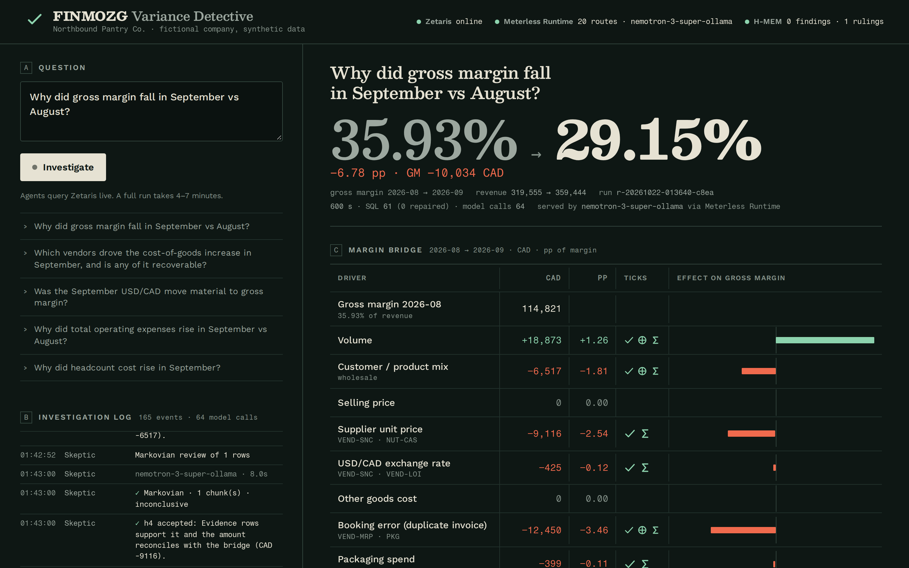

# FINMOZG Variance Detective

**An agent team that tells a controller why gross margin moved this month, and proves every driver with rows from the ledger, purchasing, sales and bank systems, queried through Zetaris.**

Open Agent Hackathon 2026 · Track 02 **The Agent That Can Explain Why** · solo build by Maksym Stepanenko (INNOVA CONSULT, Ottawa).

> Data is synthetic: *Northbound Pantry Co.* is a fictional Ottawa specialty-food importer generated by code in this repo. USD/CAD rates are real Bank of Canada data. Output is decision support; a controller signs off.



## The problem

At month-end close the same question comes back: *"Gross margin fell from 35.9 % to 29.2 %. Why?"* The answer is split across systems that share no keys. The general ledger says **what** moved, purchasing/AP says **which vendor and at what price**, the order export says **which customers and products**, the bank says **what cash actually left**. A controller spends one to two days per close exporting to spreadsheets, and still mixes real causes with booking errors: an invoice posted twice looks like a cost increase until someone checks the bank.

## What it does

Ask a question in plain English. The agents:

1. **Recall** what earlier closes taught them (Meterless **H-MEM**): the schema map, findings the controller confirmed, rulings.
2. **Map** the data through the Zetaris **Unified Semantic Layer** `finance_usl` (Cartographer).
3. **Plan** testable hypotheses: price, volume, customer mix, supplier price vs contract, USD/CAD, booking errors, packaging, plus the largest movement elsewhere in the P&L that someone might blame (Planner, NVIDIA Nemotron).
4. **Investigate** each hypothesis in parallel with a `run_sql` tool against Zetaris, repairing SQL from the error message when a query fails (Investigators).
5. **Compute** the exact margin bridge with deterministic code, no model arithmetic (Quant).
6. **Veto** anything without evidence (Skeptic): no rows → rejected; an amount that does not reconcile with the bridge → sent back; a cost claim not confirmed in the bank → sent back; a claim that does not name the vendor or customer the drill-down shows → sent back; operating expenses offered as a gross-margin driver → struck out. Long evidence sets are reviewed in bounded chunks by the Meterless **Markovian** engine.
7. **Write** a memo where every figure cites its evidence (`[E8-2]`, `[Q-duplicates]`); a deterministic reviewer rejects any CAD amount that is not in the facts.
8. **Learn**: the controller clicks *Confirm* or *Reject*; the memory steward stores it in H-MEM and the next close starts warm.

All agents share one evidence graph (Meterless **World Model**): Question ← Hypothesis ← Finding ← Evidence → Vendor / Invoice / Customer, every write attributed to the agent that made it.

### Result on the September question (real run)

| Driver | CAD | pp of margin | Named by the agents |
|---|---:|---:|---|
| Booking error | −12,450 | −3.46 | Maple Ridge Packaging invoice MRP-88213 booked twice in AP, paid once in the bank |
| Supplier unit price | −9,116 | −2.54 | Sierra Nut Co. invoiced above contract on 3 nut SKUs (CAD 9,143 over contract) |
| Customer mix | −6,517 | −1.81 | Capital Wholesale Grocers volume 1,102 → 2,353 units at wholesale prices |
| USD/CAD | −425 | −0.12 | real BoC rates on USD invoices: measured, immaterial |
| Packaging spend | −399 | −0.11 | after removing the duplicate |
| Volume | +18,873 | +1.26 | more units sold |
| Unexplained residual | 0 | 0.00 | shown openly |

Struck out by the Skeptic: *selling prices changed* (bridge measures CAD 0) and *marketing spend rose* (opex, below gross margin: the planted red herring).

## Evaluation (honest numbers)

The generator plants five September causes and writes the ground truth to `eval/ground_truth.json`, which the agents never read. `npm run eval` scores runs on 22 checks: the bridge against truth (9), each planted cause found, accepted and named in the memo (7), the red herring rejected, memo completeness, residual stated, sign-off caveat, citations resolving, evidence rows present.

| Build stage (22 Oct) | Score |
|---|---|
| First end-to-end run | 16 / 22 |
| + Skeptic challenges false negatives, coverage check, analyst playbooks | 21 / 22 |
| + Quant drill-downs and the entity cross-check | **22 / 22** |

Every run's eval output is in `eval/results-*.json`; traces are in `logs/` (sample runs in `recordings/runs/`).

## Sponsor technology

### Zetaris (data)
- Local Zetaris platform (Docker). Five sources registered by `npm run zetaris:register` (`sql/zetaris/register_sources.sql`): **FM_ERP** and **FM_PROCURE** (Postgres via JDBC `CREATE DATASOURCE` + `REGISTER DATASOURCE TABLES`), **FM_ORDERS** (CSV file store), **FM_BANK** (REST table over the bank-feed service), **FM_BOC** (REST table over the live Bank of Canada Valet API).
- **Unified Semantic Layer** `finance_usl` (`sql/usl/finance_usl_create.sql`): 9 business tables with primary and foreign keys, activated from the raw sources, e.g. `vendor_bill` keyed by vendor invoice number with the BoC rate on the invoice date, `purchase_line` with contract price and landed CAD cost. `RUN DQ` on the USL flags the duplicated invoice on its own (PK rule: 31 records, 2 invalid, both MRP-88213) and the marketing payment with no AP bill (FK rule). Evidence: `docs/evidence/zetaris-usl-checks.txt`.
- Agents reach data **only** through `POST /api/v1.0/sql-editor/sqls/run`; every statement, row count and query id is in the trace.

### Meterless (build: three engines; power: the Runtime provider)
- **H-MEM** (`src/memory/hmem.ts`): cross-run memory: schema map (a warm run skips discovery), controller-confirmed or rejected findings, Skeptic rulings; retrieval trace and ledger audit per memory.
- **World Model** (`src/evidence/worldModel.ts`): the shared evidence graph all agents read and write through a single-writer queue with provenance per write; idempotent re-ingest.
- **Markovian** (`src/review/markovian.ts`): the Skeptic's chunked review of evidence rows with compressed carryover and estimated token accounting (`logs/markovian-runs.jsonl`).
- The three reference engines are vendored unchanged from github.com/Meterless/Meterless (Apache-2.0) in `src/engines/`; `npm run conformance` runs the official suites against our copies: H-MEM 13/13, World Model 8/8, Markovian 8/8 (`docs/evidence/conformance-*.txt`).
- **Power:** `src/llm/providers/meterless.ts` implements the Meterless Runtime provider contract v4 (`docs/reference/meterless-provider-contract-v4.md`): URL normalisation, Bearer token from `<stateDir>/proxy-token`, `meterless-app` / `meterless-scope` headers, status from `GET /v1/models` (401 → unauthorized), Auto Detect, connect links, 180 s timeout. It is the default provider; every model call in the demo goes app → Meterless Runtime → Nemotron lane, and the signed compute receipt's `routed_model` is logged per call. `npm run provider:check` → `docs/evidence/provider-check.txt`. How the Runtime runs on our x86 Linux box: `ops/meterless-runtime-x86/README.md`.

### NVIDIA
NVIDIA **Nemotron 3 Super** serves every model call: planning, the Investigators' tool calls and SQL repairs, the Skeptic's Markovian review, and the memo. Pinned through a Meterless Runtime lane (`METERLESS_MODEL_DEEP/FAST`); the same code runs on build.nvidia.com with `LLM_PROVIDER=nvidia`.

### Cursor
Development happened in a Cursor project (`.cursor/rules/`) with the Cursor Agent CLI. `docs/cursor-sessions.md` lists every Cursor session with its prompt and the files it wrote, and, separately, the code written outside Cursor after the Cursor free plan hit its usage limit on 22 Oct (the hackathon Cursor credit had not been issued; question posted in HackOS Help Cursor).

### What was unique
- The Skeptic is deterministic first: it checks claims against the Quant bridge and the Quant drill-down, demands bank confirmation for cost claims, and **challenges false negatives** ("you found nothing, but the bridge measures CAD 6,517 for mix: find the rows").
- Zetaris USL data-quality rules are part of the investigation: the duplicate invoice is visible as a PK violation before any agent asks.
- Memory turns a confirmed finding into a first check at the next close.
- An eval harness scores the agent against planted ground truth instead of eyeballing the memo.

## Quick start

### A. Sample mode (no Zetaris, no keys, about a minute)
```bash
git clone https://github.com/ctmakc/finmozg-variance-detective && cd finmozg-variance-detective
npm install
SAMPLE_MODE=true npm run agent -- --input input_examples/01-gm-drop-sep.json
SAMPLE_MODE=true npm run serve        # UI at http://127.0.0.1:8795
# or: docker build -t finmozg-vd . && docker run -p 8795:8795 finmozg-vd
```
Sample mode replays the recorded Zetaris results and Nemotron replies of real live runs (`recordings/`), labelled as recordings.

### B. Live
Requirements: Node 20+, Docker, a local Zetaris install (Zetaris Cloud → Run locally; `verify.sh` 9/9), Meterless Nightshift (or any OpenAI-compatible Nemotron endpoint).
```bash
cp .env.example .env                  # Zetaris API key, Runtime token or token file
npm install
npm run generate                      # synthetic data (seeded) + eval/ground_truth.json
docker compose up -d                  # Postgres ×2 + bank feed, on the zetaris_default network
npm run zetaris:register              # 5 sources in Zetaris
npm run zetaris:usl                   # finance_usl compile + activate + DQ
npm run provider:check                # Meterless Runtime status, routes, a tool call
npm run agent -- --input input_examples/01-gm-drop-sep.json
npm run serve                         # API + UI
npm run eval                          # score the latest run against ground truth
npm test && npm run conformance
```

### API
```
POST /run              {"question": "..."}           → {runId}   (?wait=1 returns the full result)
GET  /runs/:id         result JSON (memo, bridge, findings, evidence, stats)
GET  /runs/:id/events  live agent trace (server-sent events)
POST /feedback         {"runId","findingId","verdict":"confirmed"|"rejected","note"}
GET  /health           Zetaris + Meterless Runtime status
```

## Sample inputs and outputs
| Input | Output |
|---|---|
| `input_examples/01-gm-drop-sep.json` Why did gross margin fall in September vs August? | `recordings/runs/01-gm-drop-sep.memo.md` |
| `02-vendors-recoverable.json` Which vendors drove the COGS increase, is any of it recoverable? | `recordings/runs/02-vendors-recoverable.memo.md` |
| `03-fx-material.json` Was the September USD/CAD move material? | `recordings/runs/03-fx-material.memo.md` |
| `04-opex-rise.json` Why did operating expenses rise? | `recordings/runs/04-opex-rise.memo.md` |
| `05-headcount.json` Why did headcount cost rise? (no payroll source) | `recordings/runs/05-headcount.memo.md` |

## Repository map
```
src/agents/        planner, cartographer, investigator, quant, skeptic, writer, steward
src/orchestrator.ts  the bounded state machine and JSONL trace
src/zetaris/       REST client (record/replay), statement splitter
src/llm/           Meterless Runtime provider (primary), OpenAI-compatible/NVIDIA provider
src/engines/       vendored Meterless H-MEM, World Model, Markovian (Apache-2.0)
src/memory, src/evidence, src/review   our integrations of the three engines
sql/               Zetaris source registration and the finance_usl semantic layer
scripts/           data generator, Zetaris setup, eval, provider check, sample recorder
ui/                the web UI (see DESIGN.md)
ops/               how the Meterless Runtime runs on x86 Linux
docs/              architecture spec, Cursor session log, evidence, references
```

## Pre-existing components (declared)
- Planning documents written 15–21 Oct 2026 (no code): plan and demo outline, outside this repo.
- FINMOZG (our separate product): domain ideas only (variance analysis concepts); no code copied.
- Meterless reference engines and conformance suites (Apache-2.0), vendored unchanged.
- Zetaris getting-started docs and examples (Apache-2.0) copied into `docs/reference/` for the coding agent.
- Bank of Canada Valet FX data (public). Everything else was written after 22 Oct 2026 00:00 UTC.

## Limits
- Synthetic data; one fictional company; goods are assumed bought in the month they are sold (no inventory carry).
- Gross-margin questions are the deep path; other questions use the same agents with less specialised checks.
- A live run takes 6–10 minutes (dozens of Nemotron calls and Zetaris queries). Sample mode exists for judges.

License: Apache-2.0.
